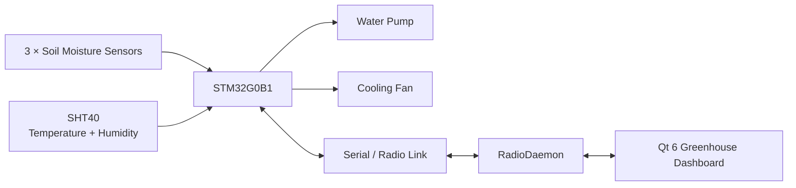

<table align="right">
  <tr>
    <td><b>🇬🇧 English</b></td>
    <td><a href="./README_RU.md">🇷🇺 Русский</a></td>
  </tr>
</table>

# 🌱 Automated Greenhouse Controller

A compact automated greenhouse control system based on **STM32G0B1**.

The controller monitors:

- air temperature;
- air humidity;
- soil moisture from three analog sensors;

and controls:

- a water pump;
- an active cooling / ventilation fan.

The embedded controller communicates with a Qt desktop application through the same framed radio protocol used by the other devices in the room-control system.

---

## ⚙️ System Architecture



The STM32 handles sensing and local control.

The desktop application provides monitoring, manual commands and configuration.

---

## 🔧 Embedded Controller

The firmware runs on **STM32G0B1**.

It uses the custom register-level [HAL](https://github.com/suneids/HAL) library.

Main peripherals:

- ADC;
- DMA;
- I²C;
- USART;
- TIM / PWM;
- SysTick;
- RTC / low-power infrastructure.

---

## 🌡 Air Temperature and Humidity

Air conditions are measured using an **SHT40** sensor connected through I²C.

The firmware requests a high-precision measurement and reads the resulting six-byte frame.

Raw values are converted using:

```text
Temperature:
T = -45 + 175 × raw / 65535

Relative humidity:
RH = -6 + 125 × raw / 65535
```

Relative humidity is then limited to the physical `0...100%` range.

---

## 🌱 Soil Moisture

Three analog soil-moisture channels are sampled by the STM32 ADC.

```text
Soil sensor 1 ─┐
Soil sensor 2 ─┼→ ADC → DMA → soil_raw[3]
Soil sensor 3 ─┘
```

DMA continuously transfers ADC measurements into memory.

The firmware uses the average value of all three channels:

```c
avg_soil_h =
    (soil_raw[0] +
     soil_raw[1] +
     soil_raw[2]) / 3;
```

This reduces dependence on a single measurement point.

A configurable raw ADC threshold determines when the soil is considered dry.

---

## 💧 Watering Control

The pump is driven through PWM.

To improve startup reliability, the firmware initially applies full power:

```text
100% PWM
   ↓
300 ms startup
   ↓
requested duty
```

Automatic watering uses a repeated **water → soak → re-measure** cycle.

Current logic:

```text
Read soil moisture
      ↓
Soil dry?
      ↓ yes
Run pump for 20 s
      ↓
Wait 20 s
      ↓
Measure again
```

The cycle is limited to three attempts.

This gives water time to spread through the soil before another decision is made.

The automatic algorithm also includes a `water_available` condition.

The protocol and application already expose this state, while the current firmware does not yet update it from a physical water-level sensor.

---

## 🌬 Automatic Cooling

The ventilation fan is also controlled through PWM with a full-power startup pulse.

Cooling decisions use both:

- temperature;
- relative humidity.

The thresholds change depending on current temperature.

For example:

```text
T < 25 °C
    fan ON  if RH > 75%
    fan OFF if RH < 65%

25...28 °C
    fan ON  if RH > 70%
    fan OFF if RH < 60%

T ≥ 28 °C
    fan ON  if RH > 65%
    fan OFF if RH < 55%
```

This creates hysteresis and avoids rapid switching close to one fixed threshold.

The current values are tuned around the greenhouse's intended strawberry-growing environment.

---

## 🧠 Main Control Loop

The main firmware loop continuously performs:

```text
Read sensors
     ↓
Run automation logic
     ↓
Process radio packets
     ↓
repeat
```

Conceptually:

```c
while(1) {
    GREENHOUSE_ReadState();
    GREENHOUSE_Task();
    Radio_Task(USART1);
}
```

Automation can be enabled or disabled remotely.

---

## 🎮 Manual Control

The desktop application can directly control:

- fan ON / OFF;
- pump runtime;
- automatic watering;
- automatic cooling;
- soil dryness threshold.

Current GUI provides dedicated watering commands for:

```text
20 seconds
60 seconds
```

A manual pump command is automatically stopped after the requested duration.

---

## 📡 Communication Protocol

The greenhouse uses the common framed binary protocol:

```text
AA 55 | Device ID | Command | Length | Payload | CRC16
```

| Field | Size |
|---|---:|
| SOF | 2 bytes |
| Device ID | 1 byte |
| Command | 1 byte |
| Length | 1 byte |
| Payload | variable |
| CRC16 | 2 bytes |

The greenhouse device address is:

```text
DEV_GREENHOUSE = 0x02
```

The parser is implemented as a byte-by-byte state machine and validates CRC before accepting a frame.

---

## 📟 Greenhouse Commands

| Command | ID | Function |
|---|---:|---|
| `CMD_GREENHOUSE_FAN_SET` | `0x31` | Manual fan control |
| `CMD_GREENHOUSE_PUMP_SET` | `0x32` | Timed pump control |
| `CMD_GREENHOUSE_AUTOWATER_SET` | `0x33` | Enable/disable automatic watering |
| `CMD_GREENHOUSE_AUTOVENT_SET` | `0x34` | Enable/disable automatic cooling |
| `CMD_GREENHOUSE_SOIL_LIMIT_SET` | `0x35` | Change soil threshold |
| `CMD_STATUS_REQUEST` | `0x70` | Request current state |
| `CMD_STATUS_RESPONSE` | `0x71` | Return current state |

---

## 📊 Telemetry

A status response contains:

- air temperature;
- air humidity;
- raw soil measurement;
- calculated soil percentage;
- water availability state.

The desktop application polls the controller every:

```text
5 seconds
```

and updates the user interface when a response is received.

---

## 🖥 Qt Dashboard

The desktop application is written in **Qt 6 / C++**.

It provides:

- current air temperature;
- air humidity;
- soil moisture;
- water availability;
- device online state;
- last-update timestamp;
- manual pump control;
- manual fan control;
- automatic watering toggle;
- automatic cooling toggle;
- adjustable soil threshold.

---

## 📈 Live Charts

The GUI displays separate live plots for:

### Air

- temperature;
- relative humidity.

### Soil

- calculated soil moisture.

The application keeps a rolling:

```text
300 second
```

display window.

Old samples are removed as new measurements arrive.

---

## 📻 Desktop Communication

The GUI connects to a shared local `RadioDaemon` service through `QLocalSocket`.

```text
Greenhouse GUI
      ↓
JSON IPC
      ↓
RadioDaemon
      ↓
Serial / Radio
      ↓
STM32G0B1
```

The desktop application therefore does not own the physical serial port directly.

Status polling uses request/response transactions with timeout handling.

---

## 💤 RTC and Low-Power Support

The firmware already contains support for:

- LSI clock startup;
- RTC initialization;
- RTC wake-up timer;
- STM32 Standby mode.

The intended low-power sequence is:

```text
measure / control
      ↓
turn peripherals off
      ↓
configure RTC wakeup
      ↓
Standby
      ↓
wake and repeat
```

The RTC and Standby infrastructure is implemented, but periodic sleep is currently disabled in `main()` while the controller operates continuously.

---

## 🧱 Mechanical Design

The repository also contains FreeCAD models for:

- the greenhouse body;
- mounting components.

```text
3d models/
├── Микротеплица.FCStd
└── Крепления.FCStd
```

---

## 📁 Repository Structure

```text
Greenhouse/
├── app/
│   ├── firmware/
│   │   └── stm32/
│   │       └── STM32G0B1 firmware
│   │
│   └── desktop/
│       └── Greenhouse/
│           └── Qt 6 dashboard
│
├── 3d models/
│   ├── Микротеплица.FCStd
│   └── Крепления.FCStd
│
├── README.md
└── README_RU.md
```

---

## ✅ Implemented

- [x] STM32G0B1 firmware
- [x] SHT40 temperature / humidity sensing
- [x] Three-channel soil measurement
- [x] ADC + DMA acquisition
- [x] Averaged soil measurement
- [x] PWM pump control
- [x] PWM fan control
- [x] Pump startup boost
- [x] Fan startup boost
- [x] Multi-stage automatic watering algorithm
- [x] Temperature / humidity based ventilation logic
- [x] Manual pump control
- [x] Manual fan control
- [x] Adjustable soil threshold
- [x] Binary radio protocol
- [x] CRC16 validation
- [x] Status request / response
- [x] Qt 6 monitoring application
- [x] Live temperature / humidity charts
- [x] Live soil-moisture chart
- [x] 5-second telemetry polling
- [x] RTC initialization
- [x] RTC wake-up timer support
- [x] Standby-mode implementation
- [x] FreeCAD mechanical design

### 🚧 In Progress

- [ ] Physical water-availability sensing
- [ ] Enabling periodic Standby operation in the main control cycle
