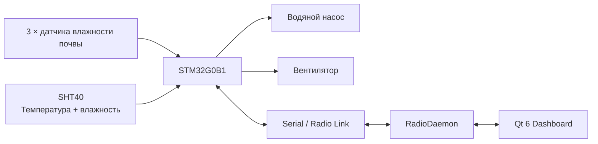

<table align="right">
  <tr>
    <td><a href="./README.md">🇬🇧 English</a></td>
    <td><b>🇷🇺 Русский</b></td>
  </tr>
</table>

# 🌱 Автоматизированная микротеплица

Компактная система автоматического управления теплицей на базе **STM32G0B1**.

Контроллер измеряет:

- температуру воздуха;
- влажность воздуха;
- влажность почвы по трём аналоговым датчикам;

и управляет:

- водяным насосом;
- вентилятором охлаждения / вентиляции.

Embedded-контроллер связан с Qt-приложением через общий бинарный радиопротокол, используемый другими устройствами системы управления комнатой.

---

## ⚙️ Архитектура системы



STM32 выполняет измерения и локальную автоматику.

Desktop-приложение используется для мониторинга, ручного управления и настройки параметров.

---

## 🔧 Embedded-контроллер

Прошивка работает на **STM32G0B1**.

Используется собственная register-level библиотека [HAL](https://github.com/suneids/HAL).

Основная периферия:

- ADC;
- DMA;
- I²C;
- USART;
- TIM / PWM;
- SysTick;
- RTC / low-power infrastructure.

---

## 🌡 Температура и влажность воздуха

Параметры воздуха измеряются датчиком **SHT40**, подключённым по I²C.

Прошивка запускает высокоточную конверсию и считывает шестибайтный результат.

Преобразование выполняется по формулам:

```text
Температура:
T = -45 + 175 × raw / 65535

Относительная влажность:
RH = -6 + 125 × raw / 65535
```

Полученная влажность ограничивается физическим диапазоном `0...100%`.

---

## 🌱 Влажность почвы

Используются три аналоговых канала измерения почвы.

```text
Датчик 1 ─┐
Датчик 2 ─┼→ ADC → DMA → soil_raw[3]
Датчик 3 ─┘
```

DMA непрерывно переносит результаты АЦП непосредственно в память.

Для управления используется среднее значение трёх датчиков:

```c
avg_soil_h =
    (soil_raw[0] +
     soil_raw[1] +
     soil_raw[2]) / 3;
```

Так решение меньше зависит от одного конкретного участка почвы.

Порог сухой почвы можно изменять удалённо.

---

## 💧 Управление поливом

Насос управляется через PWM.

Для надёжного запуска сначала кратковременно подаётся полная мощность:

```text
100% PWM
   ↓
300 ms
   ↓
рабочий duty
```

Автоматический полив построен как цикл:

```text
Измерение почвы
      ↓
Почва сухая?
      ↓ да
Полив 20 секунд
      ↓
Ожидание 20 секунд
      ↓
Повторное измерение
```

Количество попыток ограничено тремя.

Пауза после полива позволяет воде распределиться по почве до следующего измерения.

В автоматическом алгоритме также учитывается флаг:

```text
water_available
```

Протокол и GUI уже умеют работать с этим состоянием, однако в текущей прошивке физический датчик наличия воды ещё не подключён к логике обновления этого флага.

---

## 🌬 Автоматическая вентиляция

Вентилятор также управляется через PWM и получает стартовый импульс полной мощности.

Решение о включении зависит одновременно от:

- температуры;
- влажности воздуха.

Используются разные диапазоны.

Например:

```text
T < 25 °C
    ON  при RH > 75%
    OFF при RH < 65%

25...28 °C
    ON  при RH > 70%
    OFF при RH < 60%

T ≥ 28 °C
    ON  при RH > 65%
    OFF при RH < 55%
```

Разница между порогами включения и выключения создаёт гистерезис и уменьшает постоянное переключение вентилятора около одной точки.

Текущие значения настроены под условия выращивания клубники.

---

## 🧠 Основной цикл

Прошивка непрерывно выполняет:

```text
Считать датчики
      ↓
Выполнить автоматику
      ↓
Обработать радиопакеты
      ↓
повтор
```

Основная логика:

```c
while(1) {
    GREENHOUSE_ReadState();
    GREENHOUSE_Task();
    Radio_Task(USART1);
}
```

Автоматический полив и вентиляцию можно независимо включать и выключать удалённо.

---

## 🎮 Ручное управление

Desktop-приложение позволяет вручную управлять:

- вентилятором;
- насосом;
- автоматическим поливом;
- автоматической вентиляцией;
- порогом сухой почвы.

Для насоса в интерфейсе предусмотрены команды полива:

```text
20 секунд
60 секунд
```

После заданного времени прошивка самостоятельно выключает насос.

---

## 📡 Протокол связи

Используется общий бинарный протокол:

```text
AA 55 | Device ID | Command | Length | Payload | CRC16
```

| Поле | Размер |
|---|---:|
| SOF | 2 байта |
| Device ID | 1 байт |
| Command | 1 байт |
| Length | 1 байт |
| Payload | переменный |
| CRC16 | 2 байта |

Адрес теплицы:

```text
DEV_GREENHOUSE = 0x02
```

Приём реализован как побайтовый state-machine parser.

Перед обработкой пакета проверяется CRC16.

---

## 📟 Команды теплицы

| Команда | ID | Назначение |
|---|---:|---|
| `CMD_GREENHOUSE_FAN_SET` | `0x31` | Ручное управление вентилятором |
| `CMD_GREENHOUSE_PUMP_SET` | `0x32` | Управление насосом по времени |
| `CMD_GREENHOUSE_AUTOWATER_SET` | `0x33` | Автоматический полив |
| `CMD_GREENHOUSE_AUTOVENT_SET` | `0x34` | Автоматическая вентиляция |
| `CMD_GREENHOUSE_SOIL_LIMIT_SET` | `0x35` | Порог сухой почвы |
| `CMD_STATUS_REQUEST` | `0x70` | Запрос состояния |
| `CMD_STATUS_RESPONSE` | `0x71` | Ответ с телеметрией |

---

## 📊 Телеметрия

Ответ контроллера содержит:

- температуру воздуха;
- влажность воздуха;
- raw-значение почвы;
- рассчитанный процент влажности;
- состояние наличия воды.

Desktop-приложение запрашивает состояние каждые:

```text
5 секунд
```

и обновляет интерфейс после получения ответа.

---

## 🖥 Qt Dashboard

Приложение написано на **Qt 6 / C++**.

В интерфейсе отображаются:

- температура воздуха;
- влажность воздуха;
- влажность почвы;
- наличие воды;
- Online state;
- время последнего обновления.

Также доступны:

- ручное включение вентилятора;
- ручной полив;
- автоматический полив;
- автоматическая вентиляция;
- настройка порога сухой почвы.

---

## 📈 Графики

Qt-приложение строит отдельные live-графики.

### Воздух

- температура;
- относительная влажность.

### Почва

- рассчитанная влажность.

Отображается скользящее окно:

```text
300 секунд
```

Старые точки автоматически удаляются.

---

## 📻 Desktop-связь

GUI подключается к общему локальному `RadioDaemon` через `QLocalSocket`.

```text
Greenhouse GUI
      ↓
JSON IPC
      ↓
RadioDaemon
      ↓
Serial / Radio
      ↓
STM32G0B1
```

Таким образом GUI не владеет физическим serial port напрямую.

Polling состояния выполняется как request/response с контролем timeout.

---

## 💤 RTC и Low-Power

В прошивке уже реализованы:

- запуск LSI;
- инициализация RTC;
- RTC Wakeup Timer;
- переход STM32 в Standby.

Предполагаемая схема работы:

```text
измерение / управление
        ↓
выключение периферии
        ↓
RTC wakeup
        ↓
Standby
        ↓
пробуждение
```

Инфраструктура RTC и Standby уже существует, но периодический сон в текущем `main()` отключён, поэтому контроллер пока работает непрерывно.

---

## 🧱 Механика

В репозитории находятся FreeCAD-модели:

- корпуса микротеплицы;
- крепёжных элементов.

```text
3d models/
├── Микротеплица.FCStd
└── Крепления.FCStd
```

---

## 📁 Структура репозитория

```text
Greenhouse/
├── app/
│   ├── firmware/
│   │   └── stm32/
│   │       └── прошивка STM32G0B1
│   │
│   └── desktop/
│       └── Greenhouse/
│           └── Qt 6 dashboard
│
├── 3d models/
│   ├── Микротеплица.FCStd
│   └── Крепления.FCStd
│
├── README.md
└── README_RU.md
```

---

## ✅ Реализовано

- [x] Прошивка STM32G0B1
- [x] SHT40
- [x] Измерение температуры воздуха
- [x] Измерение влажности воздуха
- [x] Три канала датчиков почвы
- [x] ADC + DMA
- [x] Усреднение измерений почвы
- [x] PWM-управление насосом
- [x] PWM-управление вентилятором
- [x] Стартовый boost насоса
- [x] Стартовый boost вентилятора
- [x] Многоэтапный алгоритм автоматического полива
- [x] Автоматическая вентиляция по температуре и влажности
- [x] Ручное управление насосом
- [x] Ручное управление вентилятором
- [x] Настраиваемый порог сухой почвы
- [x] Собственный бинарный протокол
- [x] CRC16
- [x] Status request / response
- [x] Qt 6 desktop-приложение
- [x] Live-графики воздуха
- [x] Live-график влажности почвы
- [x] Polling каждые 5 секунд
- [x] RTC initialization
- [x] RTC Wakeup Timer
- [x] Standby mode
- [x] FreeCAD-модели

### 🚧 В процессе

- [ ] Физическое определение наличия воды
- [ ] Включение периодического Standby в основной рабочий цикл
